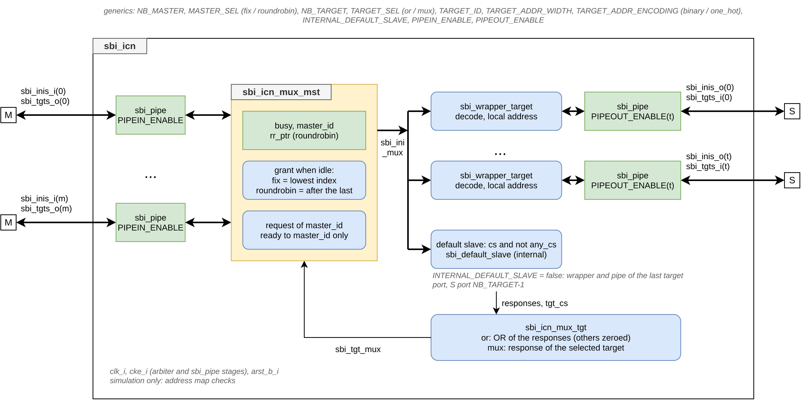
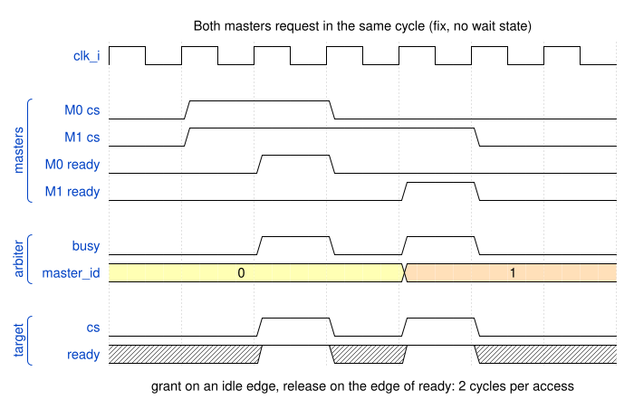

<!--
  README MODEL (common to every Asylum IP, keep the same headings)
  ----------------------------------------------------------------
  Regenerate from the sources, never from the previous README text alone:
    hdl/*.vhd (entities, generics, ports), hdl/csr/*.hjson (register map),
    <IP>.core (VLNV, targets, depends), mk/targets.txt, sim/, syn/, esw/.
  Sections, in this order:
    badges / title + one-line pitch / Overview / Features / Block Diagram /
    Getting Started / Hardware Interfaces / Configuration / Resources /
    Theory of Operation / Registers / Programmer's Guide /
    Design Verification / Dependencies and Related IPs / License
  Rules:
    - English, short and factual: every statement backed by the sources.
    - No VLNV line: the version badge shows it.
    - Badges: first line version, license; second line CI, lint, sim, syn.
    - Block diagram and FSM: pages Overview and FSM of doc/<NAME>.drawio, exported to
      doc/<NAME>-Overview.png and doc/<NAME>-FSM.png (make -C doc).
    - Timing diagrams: WaveDrom source doc/<NAME>-<what>.json, rendered
      doc/<NAME>-<what>.svg (make -C doc), shown as images.
    - No CPU named (OpenBlaze, PicoBlaze, RISC-V) outside the CPU and SoC IPs.
    - Registers: link to the generated hdl/csr/<X>_csr.md, never copy the tables.
    - Tables: Configuration = Name|Type|Default|Description,
      Hardware Interfaces = Name|Direction|Type|Description, grouped by interface.
    - A section with nothing to say is one line ("This IP has no
      software-visible registers."), never removed.
-->
[](https://github.com/deuskane/asylum-infrastructure_icn/tags)
[](LICENSE)

[](https://github.com/deuskane/asylum-infrastructure_icn/actions/workflows/ci.yml)
[](https://github.com/deuskane/asylum-infrastructure_icn/actions/workflows/ci.yml)
[](https://github.com/deuskane/asylum-infrastructure_icn/actions/workflows/ci.yml)
[](https://github.com/deuskane/asylum-infrastructure_icn/actions/workflows/ci.yml)

# SBI interconnect

**A small, readable bus interconnect in VHDL: N masters to M targets on the SBI bus, fixed-priority or round-robin arbitration, binary or one-hot address decoding, default slave and optional pipeline stages.**

Part of the [Asylum project](https://github.com/deuskane/asylum-project), a collection of small IP cores, written to be read and learned from.

## Table of Contents

1. [Overview](#overview)
2. [Features](#features)
3. [Block Diagram](#block-diagram)
4. [Getting Started](#getting-started)
5. [Hardware Interfaces](#hardware-interfaces)
6. [Configuration](#configuration)
7. [Resources](#resources)
8. [Theory of Operation](#theory-of-operation)
9. [Registers](#registers)
10. [Programmer's Guide](#programmers-guide)
11. [Design Verification](#design-verification)
12. [Dependencies and Related IPs](#dependencies-and-related-ips)
13. [License](#license)

## Overview

`sbi_icn` connects `NB_MASTER` SBI initiators (the simple bus of Asylum) to `NB_TARGET` SBI targets:

- an arbiter grants the bus to one master at a time,
- each target has an address decoder that selects it and forwards only its local address bits,
- the responses are merged back (wired-OR or multiplexer) to the granted master,
- an access that hits no target is answered by a default slave, internal or connected to the last target port.

Optional `sbi_pipe` stages on the master ports and on the target ports cut the timing paths. In simulation, the interconnect prints its address map and stops on an invalid one (one-hot IDs, alignment, overlaps).

## Features

- `NB_MASTER` initiator ports, arbitration `"fix"` (lowest index first) or `"roundrobin"` (search starts after the last granted master)
- `NB_TARGET` target ports, each with a base address (`TARGET_ID`) and a local address width (`TARGET_ADDR_WIDTH`, 0 for a single-register target)
- Address decoding `"binary"` (address MSBs compared with the ID) or `"one_hot"` (one address bit per target)
- Response merge `"or"` (the responses of the targets not selected are zeroed, then ORed) or `"mux"` (response of the selected target)
- Default slave for the unmapped addresses: internal (`ready` at once, read data 0) or external on the last target port
- Optional registered stage per master port (`PIPEIN_ENABLE`) and per target port (`PIPEOUT_ENABLE`)
- A granted master that drops `cs` before `ready` releases the bus (the other masters are not locked out)
- Clock enable `cke_i`, asynchronous active-low reset
- Simulation only: address map report and checks, warning on an aborted transfer, report of every access to the internal default slave

## Block Diagram



## Getting Started

The cores of the Asylum IPs are published in the FuseSoC library [asylum-cores](https://github.com/deuskane/asylum-cores) (with the UVVM core used by the testbench):

```bash
pip install fusesoc
fusesoc library add https://github.com/deuskane/asylum-cores
fusesoc run --target sim_soc_arbitration asylum:infrastructure:icn  # needs GHDL
```

To use the IP in your design, add `asylum:infrastructure:icn` to the `depend` list of your core and instantiate `sbi_icn` (library `asylum`):

```vhdl
library asylum;
use     asylum.sbi_pkg.all;
use     asylum.icn_pkg.all;

  -- 2 masters, 3 targets: 0x00-0x3F, 0x40-0x7F, 0x80-0x87, the rest to the default slave
  ins_sbi_icn : sbi_icn
    generic map
    ( NAME                   => "icn"
     ,NB_MASTER              => 2
     ,MASTER_SEL             => "roundrobin"
     ,NB_TARGET              => 3
     ,TARGET_SEL             => "or"
     ,TARGET_ID              => (x"00", x"40", x"80")
     ,TARGET_ADDR_WIDTH      => (6, 6, 3)
     ,TARGET_ADDR_ENCODING   => "binary"
     ,INTERNAL_DEFAULT_SLAVE => true
     ,PIPEOUT_ENABLE         => "000"
     ,PIPEIN_ENABLE          => '0'
    )
    port map
    ( clk_i      => clk
     ,cke_i      => '1'
     ,arst_b_i   => arst_b
     ,sbi_inis_i => mst_sbi_inis   -- sbi_inis_t(1 downto 0)(addr(7 downto 0), wdata(7 downto 0))
     ,sbi_tgts_o => mst_sbi_tgts   -- sbi_tgts_t(1 downto 0)(rdata(7 downto 0))
     ,sbi_inis_o => tgt_sbi_inis   -- sbi_inis_t(2 downto 0)(addr(7 downto 0), wdata(7 downto 0))
     ,sbi_tgts_i => tgt_sbi_tgts   -- sbi_tgts_t(2 downto 0)(rdata(7 downto 0))
    );
```

[PicoSoC](https://github.com/deuskane/asylum-soc-picosoc) is a complete example: it uses three interconnects, two of them chained through the external default slave ([syn/sbi_icn_wrapper.vhd](syn/sbi_icn_wrapper.vhd) has the address maps of these two).

## Hardware Interfaces

Top-level entity: **`sbi_icn`** ([hdl/sbi_icn.vhd](hdl/sbi_icn.vhd)), component in `asylum.icn_pkg`.

### Clock and Reset

| Name | Direction | Type | Description |
|------|-----------|------|-------------|
| `clk_i` | in | std_logic | Clock, the only clock of the IP |
| `cke_i` | in | std_logic | Clock enable of the arbiter and of the `sbi_pipe` stages |
| `arst_b_i` | in | std_logic | Asynchronous reset, active low |

### Bus (SBI), masters

| Name | Direction | Type | Description |
|------|-----------|------|-------------|
| `sbi_inis_i` | in | sbi_inis_t(NB_MASTER-1 downto 0) | Requests of the masters (`cs`, `re`, `we`, `addr`, `wdata`); the widths of `addr` / `wdata` follow `sbi_inis_i(0)` |
| `sbi_tgts_o` | out | sbi_tgts_t(NB_MASTER-1 downto 0) | Responses to the masters: `ready` only for the granted master, `rdata`, `info.name = NAME` |

### Bus (SBI), targets

| Name | Direction | Type | Description |
|------|-----------|------|-------------|
| `sbi_inis_o` | out | sbi_inis_t(NB_TARGET-1 downto 0) | Requests to the targets: decoded `cs`, local address zero-extended, `re` / `we` / `wdata` of the granted master |
| `sbi_tgts_i` | in | sbi_tgts_t(NB_TARGET-1 downto 0) | Responses of the targets (`ready`, `rdata`, `info`; `info.name` is used in the simulation reports) |

The response data width is `SBI_DATA_WIDTH` (8 bits, `asylum.sbi_pkg`).

## Configuration

Generics of `sbi_icn`:

| Name | Type | Default | Description |
|------|------|---------|-------------|
| `NAME` | string | `"sbi_icn"` | Instance name: `info.name` of the responses, prefix of the simulation reports |
| `NB_MASTER` | positive | `1` | Number of master ports |
| `MASTER_SEL` | string | `"fix"` | Arbitration: `"fix"` (lowest index first) or `"roundrobin"` |
| `NB_TARGET` | positive | `1` | Number of target ports (with the external default slave when `INTERNAL_DEFAULT_SLAVE = false`) |
| `TARGET_SEL` | string | `"or"` | Response merge: `"or"` (responses of the targets not selected zeroed, then ORed) or `"mux"` |
| `TARGET_ID` | sbi_addrs_t | *(none)* | Base address (`"binary"`) or select bit (`"one_hot"`) of each target |
| `TARGET_ADDR_WIDTH` | naturals_t | *(none)* | Local address width of each target: number of address LSBs forwarded |
| `TARGET_ADDR_ENCODING` | string | *(none)* | `"binary"` or `"one_hot"` |
| `INTERNAL_DEFAULT_SLAVE` | boolean | `true` | `true`: internal default slave; `false`: the last target port is the default slave (`TARGET_ID` 0, full address width) |
| `PIPEOUT_ENABLE` | std_logic_vector(NB_TARGET-1 downto 0) | `(others => '0')` | Per target port, `'1'`: `sbi_pipe` stage on the port |
| `PIPEIN_ENABLE` | std_logic | `'0'` | `'1'`: `sbi_pipe` stage on every master port |

Address map rules, checked in simulation (a violation stops the elaboration with a failure):

- `"binary"`: `TARGET_ID(t)` aligned on `2**TARGET_ADDR_WIDTH(t)`, no overlap between targets;
- `"one_hot"`: one bit set in each `TARGET_ID`, and the local address bits of every target below the select bit of every target; the default slave must then be internal (an external one needs `TARGET_ID` 0);
- external default slave: `TARGET_ID` 0 and `TARGET_ADDR_WIDTH` = address width.

## Resources

Figures of the `syn_*` targets (`make nonreg_syn`, see [Targets](#targets)): [syn/sbi_icn_wrapper.vhd](syn/sbi_icn_wrapper.vhd) (flat SBI ports, address map selected by `ADDR_MAP`) with the generics of each configuration, synthesized by Yosys and its GHDL plugin; the reports are in the build directory of each target.

| Configuration | LUT¹ | LUTRAM¹ | FF¹ | CARRY4¹ | MUXF7/F8¹ | BRAM¹ | DSP¹ | Area² (µm²) | kGE³ |
|---|---|---|---|---|---|---|---|---|---|
| `syn_default` (PicoSoC ICN2: 1 master, 10 targets, or) | 72 | 0 | 1 | 0 | 24 | 0 | 0 | 583.06 | 0.155 |
| `syn_picosoc_icn1` (1 master, 2 targets + external default slave) | 30 | 0 | 1 | 0 | 18 | 0 | 0 | 255.24 | 0.068 |
| `syn_picosoc_rr` (ICN2 map, 2 masters round robin) | 140 | 0 | 3 | 0 | 55 | 0 | 0 | 920.88 | 0.245 |
| `syn_tb` (2 masters round robin, 3 targets, mux) | 39 | 0 | 3 | 0 | 3 | 0 | 0 | 575.55 | 0.153 |
| `syn_tb_pipe` (`syn_tb` with `sbi_pipe` on the 2 master and 3 target ports) | 86 | 0 | 152 | 0 | 2 | 0 | 0 | 5709.23 | 1.521 |
| `syn_one_hot` (3 masters, 4 one-hot targets) | 52 | 0 | 3 | 0 | 0 | 0 | 0 | 721.94 | 0.192 |
| `syn_width0` (1 master, 2 single-register targets + 1 of 7 bits) | 26 | 0 | 1 | 0 | 5 | 0 | 0 | 217.71 | 0.058 |

¹ Xilinx Artix-7 (LUT6), Yosys 0.33 `synth_xilinx -flatten -noiopad -noclkbuf`, before place and route: every cell of the netlist is counted, Vivado may differ. Identical cells are merged as a vendor tool does (`opt_merge -share_all`): the inverters of an active-low reset net become one; every remaining cell is counted, an `INV` as a `LUT1`. The interconnect has no memory: no LUTRAM, no BRAM.

² SkyWater sky130 `sky130_fd_sc_hd`, typical corner (tt, 25 °C, 1.80 V), Yosys 0.33 `synth` + `dfflibmap` + `abc -liberty`: standard-cell area only, no timing constraint, no buffering, clock tree or placement.

³ Area in thousands of NAND2 gate equivalents (`sky130_fd_sc_hd__nand2_1` = 3.7536 µm²).

The interconnect is mostly combinational: the arbiter keeps `busy` (and `master_id`, `rr_ptr` with several masters); each enabled `sbi_pipe` registers a whole request and response.

## Theory of Operation

### Hierarchy

| File | Unit | Role |
|------|------|------|
| [hdl/sbi_icn.vhd](hdl/sbi_icn.vhd) | `sbi_icn` | Top level: pipe stages, arbiter, decoders, default slave, response merge, simulation checks |
| [hdl/sbi_icn_mux_mst.vhd](hdl/sbi_icn_mux_mst.vhd) | `sbi_icn_mux_mst` | Arbiter and request multiplexer |
| [hdl/sbi_wrapper_target.vhd](hdl/sbi_wrapper_target.vhd) | `sbi_wrapper_target` | Address decoder of one target: `cs`, local address, response zeroing (`"or"`) |
| [hdl/sbi_default_slave.vhd](hdl/sbi_default_slave.vhd) | `sbi_default_slave` | Internal default slave: `ready = cs`, read data 0 |
| [hdl/sbi_icn_mux_tgt.vhd](hdl/sbi_icn_mux_tgt.vhd) | `sbi_icn_mux_tgt` | Response merge (OR / mux) |
| [hdl/sbi_pipe.vhd](hdl/sbi_pipe.vhd) | `sbi_pipe` | Optional registered stage (request and response) |
| [hdl/icn_pkg.vhd](hdl/icn_pkg.vhd) | `icn_pkg` | Components of the entities above |

### Arbitration

The arbiter grants a master on a clock edge where the bus is idle (`busy = 0`) and that master has `cs = 1`: `"fix"` takes the lowest index, `"roundrobin"` searches from the master that follows the last granted one. The request reaches the targets only once `busy = 1`, and `busy` is released on the edge where the target answers `ready = 1`. An access therefore takes two cycles with a target without wait state, also with a single master:



Under contention, `"fix"` keeps the bus to master 0 as long as it requests back-to-back; `"roundrobin"` alternates.

The granted master must keep its request until `ready`. If it drops `cs` before (an aborted transfer, a protocol violation, e.g. a master reset while waiting on a slow target), the arbiter releases the bus on the next edge, so the other masters are not locked out; a simulation warning reports it. An `sbi_pipe` on the path does not follow the abort: an `sbi_pipe` that has already registered the request completes it with the target, and its response can then be returned to the next access to that target (the `abort` scenario runs without `sbi_pipe`).

### Address decoding

- `"binary"`: target `t` is selected when the address bits above `TARGET_ADDR_WIDTH(t)` equal those of `TARGET_ID(t)`; its range is `TARGET_ID(t)` to `TARGET_ID(t) + 2**TARGET_ADDR_WIDTH(t) - 1`.
- `"one_hot"`: target `t` is selected when the address bit at the index of the bit set in `TARGET_ID(t)` is 1.
- The target receives `addr(TARGET_ADDR_WIDTH(t)-1 downto 0)` zero-extended to the bus width; `re`, `we` and `wdata` go to every target, only `cs` is decoded.
- `"or"`: a target not selected has its `ready` and `rdata` forced to 0 before the OR, so a target may drive anything when it is not selected. `"mux"` takes the response of the selected target.

### Default slave

- Internal (`INTERNAL_DEFAULT_SLAVE = true`): `sbi_default_slave` gets `cs` when no target is selected and answers at once (`ready = cs`) with read data 0; writes are ignored.
- External (`INTERNAL_DEFAULT_SLAVE = false`): the last target port gets the accesses that no other target claims, with the full address (`TARGET_ID` 0, full width). Chaining two interconnects this way gives a hierarchical address map.

### Latency

From the request of a master to its `ready`, with the bus idle: 2 cycles (grant, then the answer of the target) + the wait states of the target + 2 cycles per enabled `sbi_pipe` on the path (master port, target port; the internal default slave has no target port). The `latency` scenario checks this for every target port and both masters.

### Clock enable

`cke_i = 0` freezes the arbiter and the `sbi_pipe` stages: a pending request is not granted, an access in a pipe stage waits. The path from a granted master to its target is combinational: a target that answers at once completes the access even when `cke_i = 0`.

## Registers

This IP has no software-visible registers.

## Programmer's Guide

This IP has no software-visible registers: software sees the targets at the addresses of `TARGET_ID`, and reads 0 at an unmapped address with the internal default slave.

## Design Verification

### Testbench

| File | DUT | Description |
|------|-----|-------------|
| [sim/icn/tb_sbi_icn.vhd](sim/icn/tb_sbi_icn.vhd) | `sbi_icn` | Self-checking UVVM testbench: 2 masters (SBI VIP, or driven cycle by cycle for the arbitration, latency and reset scenarios), 3 memory targets that answer after `WAIT_STATES*i` cycles, internal default slave or a memory model on a 4th target port. Out of an access a target drives `ready = 1` and `rdata = 0xFF`, and wrong data during its wait states, so the `"or"` zeroing and the `"mux"` selection are checked. Monitors on every cycle: a master gets `ready` only while it requests, at most one master gets `ready` and at most one target port is selected, `ready` / `cs` never X, a target sees its local address and either `re` or `we`. Generics `TESTS_LIST`, `MASTER_SEL`, `TARGET_SEL`, `TARGET_ADDR_ENCODING` (binary: targets at 0x00 / 0x40 / 0x80, 6-bit local addresses; one-hot: 0x20 / 0x40 / 0x80, 5 bits), `INTERNAL_DEFAULT_SLAVE`, `WAIT_STATES`, `PIPEIN`, `PIPEOUT`. One package per scenario (`tb_sbi_icn_<name>_pkg`), names, applicability and dispatch in [tb_sbi_icn_tests_pkg](sim/icn/tb_sbi_icn_tests_pkg.vhd), helpers (accesses, cycle-driven accesses, concurrent masters, reset pulse) in [tb_sbi_icn_bfm_pkg](sim/icn/tb_sbi_icn_bfm_pkg.vhd) |

### Scenarios (`TESTS_LIST`)

The scenarios are chosen at run time with the generic `TESTS_LIST`: names separated by `,` without space (`latency,reset,latency`), a name may be repeated. The sequencer first checks every name (an unknown name, or a scenario that does not apply to the configuration, is a `TB_ERROR` before any scenario runs), then for each scenario drives a reset pulse with the masters idle and `cke_i = 1`, logs `TEST <i>/<N> : <name>` and runs it: each scenario starts from reset and writes what it reads. The empty list (default) only compiles and elaborates the testbench. The list is parsed with `list_length` / `list_item` / `list_contains` of `asylum.string_pkg` (`asylum:utils:pkg` >= 1.10.0).

Checks counted as the `=> OK` lines of the log, reference configuration `sim_soc`:

| Name | Checks | Description |
|------|--------|-------------|
| `simple` | 9 | Each memory target written by a master and read back by the other one; the same offset of every target written with a different value and read back (an access selects one target only) |
| `default_slave` | 2 | Two unmapped addresses written and read: data 0 with the internal default slave, the written data with the external one |
| `exhaustive` | 194 | Every address of every memory target written by master 0 and read back by master 1, then accesses switching from one target to the other |
| `arbitration` | 6 | Simultaneous requests after a single access of M1, then of M0: `"fix"` grants M0 first, `"roundrobin"` the master not granted last |
| `contention` | 34 | 8 back-to-back writes per master to two targets with different wait states, then 8 cross reads: M0 granted first, alternation with `"roundrobin"`, M0 keeps the bus with `"fix"` (without input pipe) |
| `abort` | 3 | M0 drops `cs` one cycle after its grant on a slow target: M1 gets the bus one cycle later, its write is read back. Needs a memory target with wait states and no `PIPEIN` |
| `latency` | 8 | Each master alone reads every target port (and the internal default slave): cycles from the request to `ready`, see [Latency](#latency) |
| `clock_enable` | 5 | `cke_i = 0`: no grant for 8 cycles, then the latency of an idle bus; `cke_i = 0` during 4 cycles after a grant delays the access by 4 cycles |
| `reset` | 4 | A request held through a reset is served after the release with the latency of an idle bus; a reset during an access cancels it, the next access to the same target gets its own data |

Configurations:

| Configuration | `MASTER_SEL` | `TARGET_SEL` | Decoding | Default slave | `WAIT_STATES` | Pipes | Scenarios (checks) |
|---|---|---|---|---|---|---|---|
| `sim_soc` (reference) | fix | or | binary | external | 2 | none | all, one target each (265) |
| `sim_basic` | roundrobin | mux | binary | internal | 0 | none | all but `abort` (276) |
| `sim_pipe` | roundrobin | mux | binary | internal | 1 | master and target ports | all but `abort` (276) |
| `sim_one_hot` | roundrobin | or | one_hot | internal | 1 | none | all (183) |

The testbench was validated with 31 RTL mutants (arbiter priority, round-robin pointer, bus release, `busy` reset, request gating, ready routing, `cke_i`, response merge, decoders, local address, `re`, zeroing, default slave, `sbi_pipe` states and registers, pipe enables): each one is killed by at least one scenario run alone.

### Targets

| Target | Toplevel | Description |
|--------|----------|-------------|
| `default` | | HDL fileset (not a simulation) |
| `sim_soc` | `tb_sbi_icn` | Reference configuration (fix, or, external default slave, 2 wait states per target index): build and elaboration only (`TESTS_LIST` empty), base of the scenario targets |
| `sim_soc_<name>` | `tb_sbi_icn` | One target per scenario: `sim_soc_simple`, `_default_slave`, `_exhaustive`, `_arbitration`, `_contention`, `_abort`, `_latency`, `_clock_enable`, `_reset` (265 checks in all) |
| `sim_basic`, `sim_pipe`, `sim_one_hot` | `tb_sbi_icn` | Other configurations (see above), every scenario that applies |
| `lint_ghdl` | `asylum.sbi_icn_wrapper` | GHDL `-Wall` analysis and elaboration of [syn/sbi_icn_wrapper.vhd](syn/sbi_icn_wrapper.vhd) (default map: PicoSoC ICN2) |
| `lint_ghdl_width0` | `asylum.sbi_icn_wrapper` | As `lint_ghdl` with `ADDR_MAP=width0`: its empty simulation runs the address map checks of `sbi_icn` |
| `lint_ghdl_synth_<config>` | `asylum.sbi_icn_wrapper` | `ghdl --synth` check (no latch, synthesizable) for 7 configurations: `default`, `picosoc_icn1`, `picosoc_rr`, `tb`, `tb_pipe`, `one_hot`, `width0` |
| `syn_<config>` | `asylum.sbi_icn_wrapper` | Synthesis with Yosys, Artix-7 and sky130 (see [Resources](#resources)), same 7 configurations as `lint_ghdl_synth_<config>` |

The reference configuration of the testbench has a build-only base target and one target per scenario: one CI job per scenario, a failure is isolated. Every other configuration has one target that runs its whole list: the `TEST <i>/<N>` header names a failing scenario. FuseSoC replaces the `parameters` list of an inherited target, so each target repeats the generics of its configuration.

Every `sim_*`, `lint_*` and `syn_*` target is a job of the [GitHub CI](https://github.com/deuskane/asylum-infrastructure_icn/actions/workflows/ci.yml), run in the [asylum-env](https://github.com/deuskane/asylum-ci) image (GHDL, FuseSoC, UVVM, Yosys). The `sim`, `lint` and `syn` badges count the passed and failed targets of the last run on `main`.

### How to Run

From a clone of [asylum-project](https://github.com/deuskane/asylum-project) (GHDL and FuseSoC installed, or in the asylum-env image):

```bash
make help                        # variables, rules and targets
make sim_soc_arbitration         # one scenario, log in log/
make sim_pipe                    # every scenario of a configuration
make nonreg_sim                  # every sim_* target
make nonreg_lint                 # every lint_* target
make nonreg_syn                  # every syn_* target (Yosys, figures of Resources)
```

To run a list of scenarios, build the testbench once, then run the list without recompiling (same `--build-root` and `--no-export` as the Makefile, so that the build of the target is reused; any generic of the target can be overridden after the VLNV):

```bash
make sim_soc                     # build and elaboration (TESTS_LIST empty)
fusesoc --cores-root . run --build-root build --no-export --run --target sim_soc asylum:infrastructure:icn:1.4.0 --TESTS_LIST=latency,reset,latency
```

To add a scenario: a package `tb_sbi_icn_<name>_pkg` in the `sim_icn` fileset, its name in `C_TESTS` and its case in `run_test` (and `test_applies` if needed) of [tb_sbi_icn_tests_pkg](sim/icn/tb_sbi_icn_tests_pkg.vhd), a `sim_soc_<name>` target and the name in the `TESTS_LIST` of the other configurations in [ICN.core](ICN.core), then `make mk/targets.txt` and `make ci_generate`.

Outside the CI, GHDL writes a waveform `dut.fst`.

## Dependencies and Related IPs

| Core | Repository | Purpose |
|------|------------|---------|
| `asylum:utils:pkg` | [asylum-utils-pkg](https://github.com/deuskane/asylum-utils-pkg) | `sbi_pkg` (SBI records and operators), `logic_pkg`, `convert_pkg`; the testbench needs >= 1.10.0 (`string_pkg` lists of `TESTS_LIST`) |
| `asylum:utils:ghdl_synth` | [asylum-utils-generators](https://github.com/deuskane/asylum-utils-generators) | `ghdl --synth` check of the `lint_ghdl_synth_*` targets |
| `asylum:utils:yosys_synth` | [asylum-utils-generators](https://github.com/deuskane/asylum-utils-generators) | Yosys synthesis of the `syn_*` targets (Artix-7 and sky130) |
| `bitvis:verification:uvvm` | [UVVM](https://github.com/UVVM/UVVM) | Verification library and SBI VIP |

Used by [asylum-soc-picosoc](https://github.com/deuskane/asylum-soc-picosoc). All the IPs: [asylum-project](https://github.com/deuskane/asylum-project).

## License

Apache License 2.0, see [LICENSE](LICENSE).
